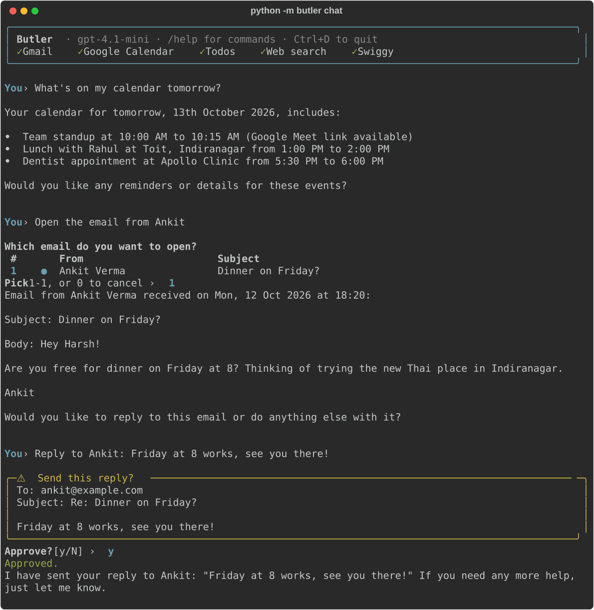

# Terminal

The quickest way to talk to Butler, with no browser or bot to set up.

## Chat

```bash
python -m butler chat
```



- **Startup banner:** the model in use, and which integrations are ready (✓), not connected (○) or need setup (✗).
- **Live replies:** answers stream in as Butler writes them, formatted as Markdown (bold, lists, tables). A status line shows what it's doing ("Searching your mail…", "Checking your calendar…").
- **Email picker:** a numbered table; ● marks unread mail. Type the number, or `0` to cancel.
- **Approvals:** a highlighted box with exactly what will happen (the email text, the order, the event), then `Approve? [y/N]`. Anything but `y` rejects.

## Commands and keys

| | |
|---|---|
| `/help` | Commands and keys |
| `/new` | Start a fresh conversation (Butler forgets the current one) |
| `/integrations` | What's connected, with details |
| `/exit`, `exit`, or **Ctrl+D** | Quit |
| **↑ / ↓** | Recall earlier messages; history is kept between sessions in `data/cli_history` |
| **Ctrl+C** | Stop the current answer (Butler stays open); at the prompt, clear the line |

Each terminal session is its own conversation, and it's forgotten when you quit. Web UI chats are saved; terminal chats aren't.

## Connect accounts

```bash
python -m butler gmail-login     # Google login in the browser
python -m butler calendar-login  # Google Calendar
python -m butler swiggy-login    # phone number + OTP in the browser
```

## Quick Gmail reader (no AI)

Prints mail straight from Gmail. It uses no OpenAI calls, so it's handy for scripts:

```bash
python -m butler gmail                                  # latest 5 in Primary
python -m butler gmail updates --from linkedin -n 10    # 10 LinkedIn mails in Updates
python -m butler gmail primary --unread --after 2026/10/01
python -m butler gmail sent --to someone@example.com
python -m butler gmail starred --attachment
```

| Option | Meaning |
|---|---|
| `category` | primary (the default), promotions, social, updates, forums, purchases, inbox, starred, snoozed, sent, drafts, important, spam, trash, all |
| `-n`, `--limit` | How many emails to show (default 5) |
| `--from`, `--to`, `--subject` | Filter by sender, recipient, or subject |
| `--text` | Free-text search |
| `--unread` | Unread mail only |
| `--attachment` | Mail with attachments only |
| `--after`, `--before` | Date range, `YYYY/MM/DD` |

## All commands

```bash
python -m butler     # lists every command, including ones integrations add
```

After `pip install -e .`, the shorter `butler <command>` works too.
