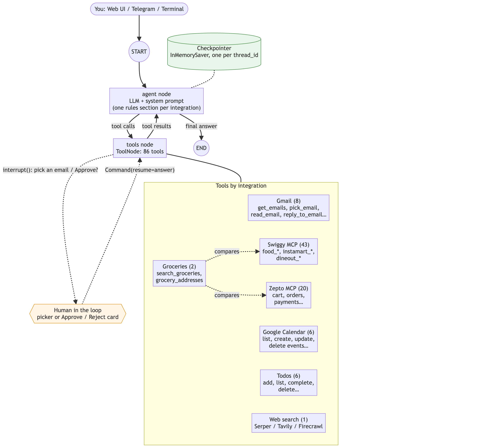

# The agent

Code: [butler/agent/graph.py](../../butler/agent/graph.py), [butler/agent/prompts.py](../../butler/agent/prompts.py), and each integration's [integration.py](../../butler/integrations/base.py)

## The graph

<p align="center"></p>

That's the compiled graph as LangGraph draws it (`graph.get_graph().draw_mermaid_png()`). With the tools, the human-in-the-loop pauses and the memory added:



```
        ┌──────────────────────────────┐
START → │ agent  (LLM with tools bound) │ ──── no tool calls ───► END
        └──────────────┬───────────────┘
                       │ tool calls
                       ▼
        ┌──────────────────────────────┐
        │ tools  (ToolNode)             │
        └──────────────┬───────────────┘
                       └────────► back to agent
```

```python
graph = StateGraph(MessagesState)
graph.add_node("agent", agent)
graph.add_node("tools", ToolNode(all_tools, handle_tool_errors=True))
graph.add_edge(START, "agent")
graph.add_conditional_edges("agent", tools_condition)   # tool calls? → "tools", else END
graph.add_edge("tools", "agent")
graph = graph.compile(checkpointer=InMemorySaver())
```

- **State** is `MessagesState`: one key, `messages`, a list. Its reducer **appends**, so each node returns only its *new* messages.
- **`agent`** calls the LLM and returns one `AIMessage`, which either contains `tool_calls` or is the final answer.
- **`tools`** runs every requested tool, possibly several at once in parallel threads, and returns one `ToolMessage` per call.
- **`tools_condition`** routes to `tools` if the last `AIMessage` has tool calls, and otherwise ends the run.

One user message can loop several times: search the menu → add to the cart → show the cart → answer.

## No router: one agent with every tool

There's no intent classifier. The LLM sees **all** tools and decides which ones to use:

- **General questions** get no tool calls and a direct answer.
- **"Unread mails in Promotions and Social"** gets two parallel `count_unread` calls.
- **"Unread mails and 15% of 240"** gets one tool call plus arithmetic in the answer.

Adding a capability means adding tools, not routes; see [Adding tools](adding-tools.md). The limit is model accuracy: with many similar tools, small models start choosing the wrong one. With everything enabled Butler has **60+ tools**, most of them Swiggy's (count them with `len(graph.get_graph().nodes['tools'].data.tools_by_name)`). Use `gpt-4.1-mini` or better, trim with `SWIGGY_SERVICES`, or eventually load only the tools relevant to each request, or split into sub-agents.

## The system prompt

`system_prompt(sections)` in [prompts.py](../../butler/agent/prompts.py) is rebuilt on **every** LLM call and never stored in memory. It's a short base plus one section per loaded integration, each written by that integration's `rules()`:

```
You are a helpful personal assistant. … Use tools only when a request
needs the user's own data …
Today is 2026/10/10.              ← so "last week" becomes a real date

<Gmail section>                   ← gmail/integration.py rules()
<Google Calendar section>         ← calendar/integration.py
<Todos section>                   ← todos/integration.py
<Web search section>              ← only if a search provider is configured
<Swiggy section>                  ← only if this user may use restricted integrations;
                                    lists only the Swiggy services that loaded
```

Each integration owns its section (`RULES` in its `integration.py`). Put workflow knowledge there that tool descriptions can't express, for example:

- **Ordering:** "call `instamart_get_cart` before `instamart_update_cart`, because updates replace the whole cart"
- **Interaction rules:** "never ask the user to choose an email in plain text; call `pick_email`"
- **Quirks of the outside service:** "`food_update_food_cart` needs `addressId` even though the schema doesn't say so"

## Per-user tool sets

```python
llm_full = llm.bind_tools(all_tools)                 # every loaded integration
llm_open = llm.bind_tools(toolset(everyone))         # minus restricted ones
```

Integrations marked `restricted = True` (Swiggy, Zepto: orders on the owner's account) are only for some users. The `agent` node reads `config["configurable"]["allow_restricted"]` and picks the matching LLM and prompt sections. A Telegram user who isn't the owner never even *sees* restricted tools. As a second line of defence, Swiggy's tools also check the same flag before running, and restricted approvals carry `"restricted": True` so only the owner can answer them.

## The model

`ChatOpenAI(model=OPENAI_MODEL, temperature=0)`, set via `OPENAI_MODEL` (default `gpt-4o-mini`).

- **Temperature 0** makes tool selection repeatable.
- **`gpt-4.1-mini`** handles multi-step flows (Swiggy carts and bookings) noticeably better. With 60+ tools, `gpt-4o-mini` has been seen inventing product IDs, picking the wrong saved address, and re-asking for confirmation.
- **Another provider:** swap `ChatOpenAI` for any LangChain chat model with tool calling (`ChatAnthropic` and others). The rest of the code doesn't care.

## Error handling

Two safety nets stop one bad tool call from breaking a conversation.

**1. Tool errors become messages, not crashes.**
`ToolNode(handle_tool_errors=True)` catches any exception a tool raises and returns it as a `ToolMessage` with `status="error"`. The LLM reads it and reacts, for example: "That email ID is invalid."

**2. Unanswered tool calls are repaired.**
OpenAI rejects a history where an `AIMessage` has a tool call with no matching `ToolMessage`. That happens if a process crashed mid-tool. Without a fix, every later message in that thread would fail with a 400. `with_tool_results()` runs before every LLM call and inserts a placeholder for each unanswered call:

```
"This tool call did not complete (it failed or was interrupted).
 Do not assume it succeeded; retry or tell the user if needed."
```

It only patches what's *sent* to the LLM; the stored history isn't modified.

## Building the agent

`build_graph()` is `async` because some integrations load their tools over the network (Swiggy's are discovered from its MCP servers). It loops over the [registry](../../butler/integrations/registry.py), calls each integration's `load_tools()`, and prints any warning it returns. It's called once at startup by each interface, and again by the web UI's **Reload agent** after connecting Swiggy. Rebuilding creates a new checkpointer, which means a fresh agent memory; see [Memory](memory.md).
